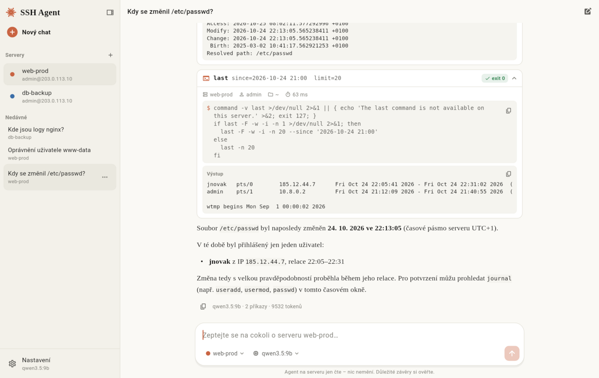
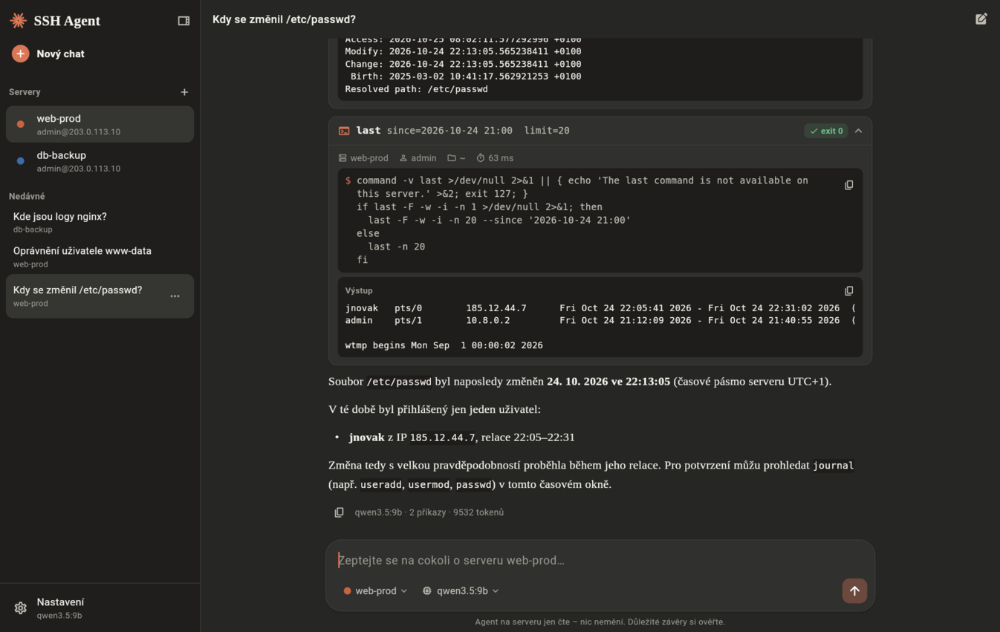
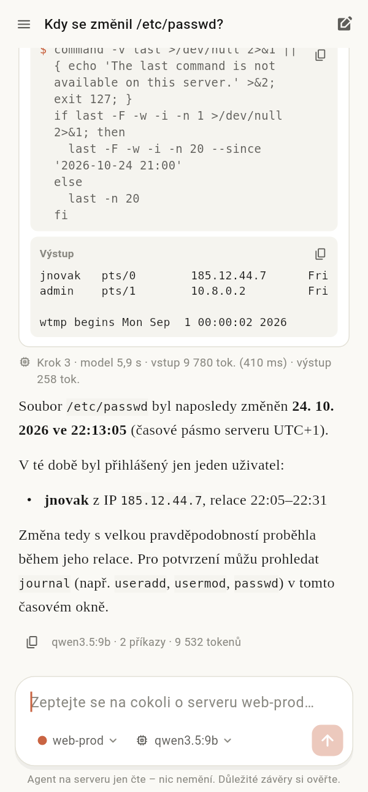
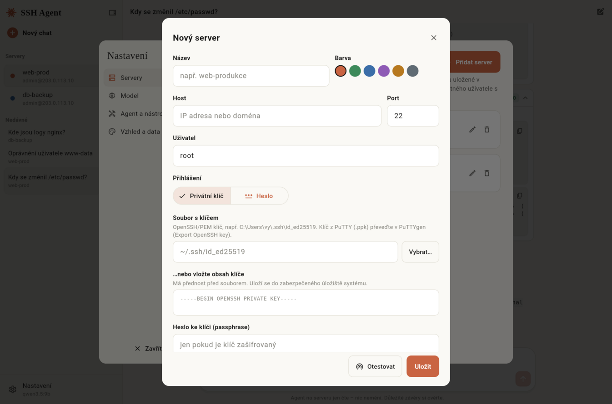
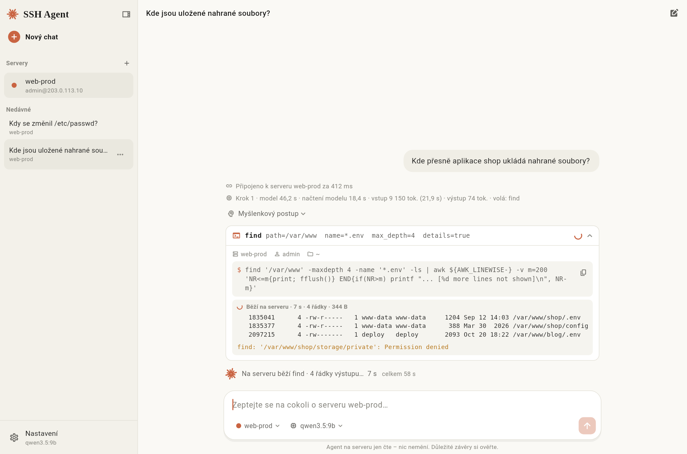

# SSH Agent

**AI agent pro Linuxové servery s rozhraním ve stylu Claude, lokálním modelem a
přístupem jen pro čtení.** Zeptáte se česky – „Kdy se změnil tento soubor?“, „Kdo se
včera přihlásil?“, „Jaká oprávnění má uživatel www-data?“ – a agent si přes SSH sám
zavolá potřebné příkazy (`stat`, `last`, `grep`, `find`, `ps`, …), přečte výsledky a
odpoví. **U každého kroku vidíte, jakou funkci volá, přesný příkaz a jeho výstup.**



| Tmavý režim | Telefon | Přidání serveru |
|---|---|---|
|  |  |  |

Během práce agenta vidíte živě, co se děje – připojení, dotaz na model (s časem
a velikostí vstupu), běžící příkaz a jeho výstup ze serveru řádek po řádku:



## Co umí

- **Chat jako v Claude** – postranní panel s konverzacemi, streamované odpovědi
  s Markdownem, sbalitelné „přemýšlení“ modelu, světlý i tmavý motiv.
- **Průběžný výpis** – místo pouhého „Pracuji…“ aplikace ukazuje, v jaké fázi agent
  je (připojuje se / model čte dotaz / přemýšlí / na serveru běží `find`…) s časem,
  u každého kroku dobu odpovědi modelu, načtení modelu a počet tokenů, a výstup
  běžícího příkazu se streamuje do karty funkce, jak přichází ze serveru.
- **Více SSH připojení** – servery přepnete jedním klikem v panelu nebo přímo
  v poli pro dotaz. Přihlášení klíčem (i šifrovaným) nebo heslem, ověření otisku
  klíče serveru, hesla a klíče v zabezpečeném úložišti systému.
- **48 předdefinovaných funkcí jen pro čtení** – pohyb po serveru (`cd`, `pwd`,
  `ls -la`, `tree`), soubory (`cat`, `head`, `tail`, `read_lines`, `grep`, `find`,
  `stat`, `diff`, komprimované logy…), uživatelé a oprávnění (`whoami`, `id`,
  `list_users` – všichni uživatelé se jménem, e‑mailem, stavem hesla a tím, zda se
  mohou přihlásit heslem i přes SSH, `user_info`, `permissions`/`namei`/ACL,
  `check_access`, `sudo_rights`, `ssh_access`), přihlášení (`last`, `lastb`, `w`),
  procesy (`ps`, `lsof`, detail procesu), služby a logy (`systemctl status`,
  `journalctl`, `crontab -l` všech uživatelů, cron, systemd timery), síť,
  balíčky, Docker, **`switch_user`** (su/sudo). Úplný seznam: [docs/NASTROJE.md](docs/NASTROJE.md).
- **Nic nemění** – žádná funkce nezapisuje, nemaže, nemění oprávnění ani služby;
  argumenty od modelu se vždy bezpečně escapují (ověřeno testy). Viz
  [docs/BEZPECNOST.md](docs/BEZPECNOST.md).
- **Lokální model** – Ollama (doporučeno), LM Studio, llama.cpp nebo jiný
  OpenAI‑kompatibilní server. Žádná data neodcházejí do cloudu.
- **Připraveno pro Android a iOS** – jeden Flutter kód, jádro v čistém Dartu.

## Rychlý start (Windows)

1. **Model:** nainstalujte [Ollamu](https://ollama.com/download) a stáhněte model:
   ```powershell
   ollama pull qwen3.5:9b
   ```
   Podrobný návod, nastavení a výběr modelu podle vašeho hardwaru:
   **[docs/LOKALNI_MODEL.md](docs/LOKALNI_MODEL.md)**.
2. **Aplikace:**
   - hotový build: GitHub → *Actions* → poslední běh *CI* → artefakt
     **`ssh-agent-windows`** (rozbalit, spustit `ssh_agent.exe`), nebo
   - ze zdrojů: nainstalujte [Flutter](https://docs.flutter.dev/get-started/install/windows/desktop)
     a Visual Studio 2022 (úloha *Desktop development with C++*), pak:
     ```powershell
     cd app
     flutter pub get
     flutter run -d windows            # vývoj
     flutter build windows --release   # → app\build\windows\x64\runner\Release\
     ```
3. V aplikaci: **Přidat server** (host, uživatel, klíč nebo heslo) → **Nastavení → Model
   → Ověřit** → ptejte se.

> Tip: pro agenta založte na serveru samostatného uživatele s právy jen pro čtení –
> návod v [docs/BEZPECNOST.md](docs/BEZPECNOST.md#doporučené-nastavení-serveru-účet-jen-pro-čtení).

## Doporučený model

| Hardware | Model |
|---|---|
| GPU 8 GB VRAM (nejčastější) | **`qwen3.5:9b`** |
| slabší PC / jen CPU | `qwen3.5:4b` |
| GPU 16–24 GB | `gemma4:26b`, `gemma4:31b` |

Zdůvodnění, srovnání kandidátů a známé problémy: [docs/LOKALNI_MODEL.md](docs/LOKALNI_MODEL.md#4-analýza-proč-právě-tyto-modely).

## Dokumentace

| Dokument | Obsah |
|---|---|
| [docs/LOKALNI_MODEL.md](docs/LOKALNI_MODEL.md) | instalace Ollamy, stažení modelu, nastavení, analýza a doporučení modelů |
| [docs/ARCHITEKTURA.md](docs/ARCHITEKTURA.md) | vrstvy aplikace, průběh dotazu, jak přidat nástroj |
| [docs/NASTROJE.md](docs/NASTROJE.md) | katalog všech funkcí agenta (generováno z kódu) |
| [docs/BEZPECNOST.md](docs/BEZPECNOST.md) | záruka read-only, rizika, doporučené nastavení serveru |
| [docs/MOBIL.md](docs/MOBIL.md) | sestavení pro Android a iOS |
| [docs/VYVOJ.md](docs/VYVOJ.md) | struktura repozitáře, testy, CLI |

## Struktura

```
app/                       Flutter aplikace (Windows · Android · iOS · macOS · Linux)
packages/ssh_agent_core/   jádro v čistém Dartu: SSH, nástroje, klienti modelů, agent, CLI
docs/                      dokumentace
```

## Stav ověření

- jádro: 49 unit testů + 54 integračních testů proti skutečnému `sshd`
  (všechny nástroje, `cd`, `sudo` i `su` s heslem, šifrovaný klíč, otisk klíče serveru,
  pokusy o shell injection),
- aplikace: widget testy (přidání serveru, celý dotaz → volání funkce → výstup →
  odpověď, mobilní rozložení, nastavení), nativní build pro Linux spuštěný proti
  skutečnému SSH serveru,
- CI (GitHub Actions) spouští testy a sestavuje Windows a Android.
